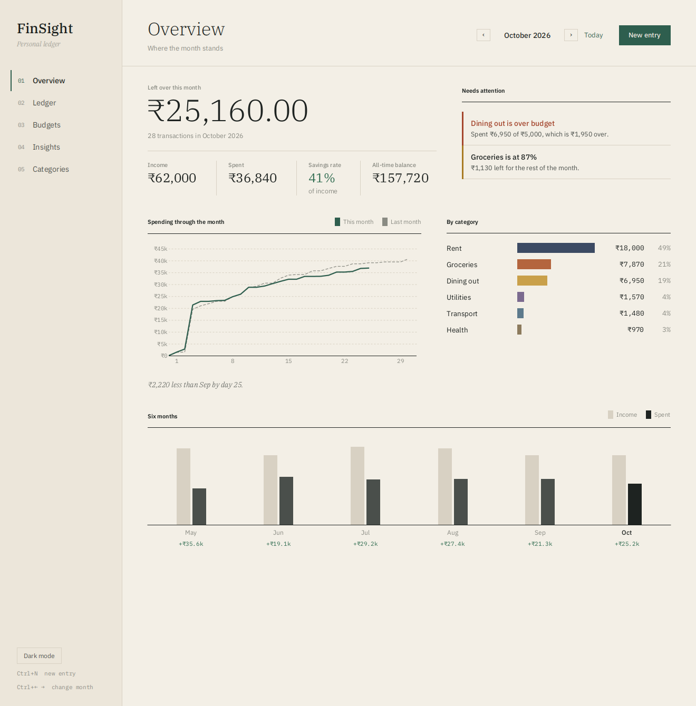
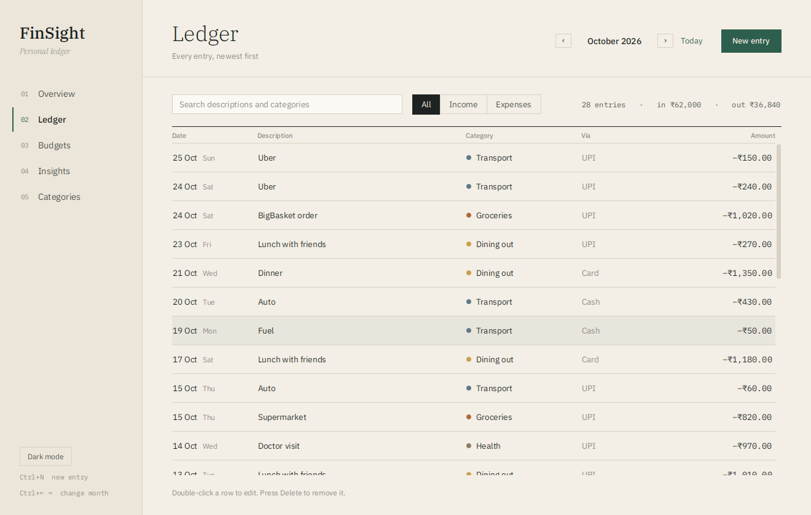
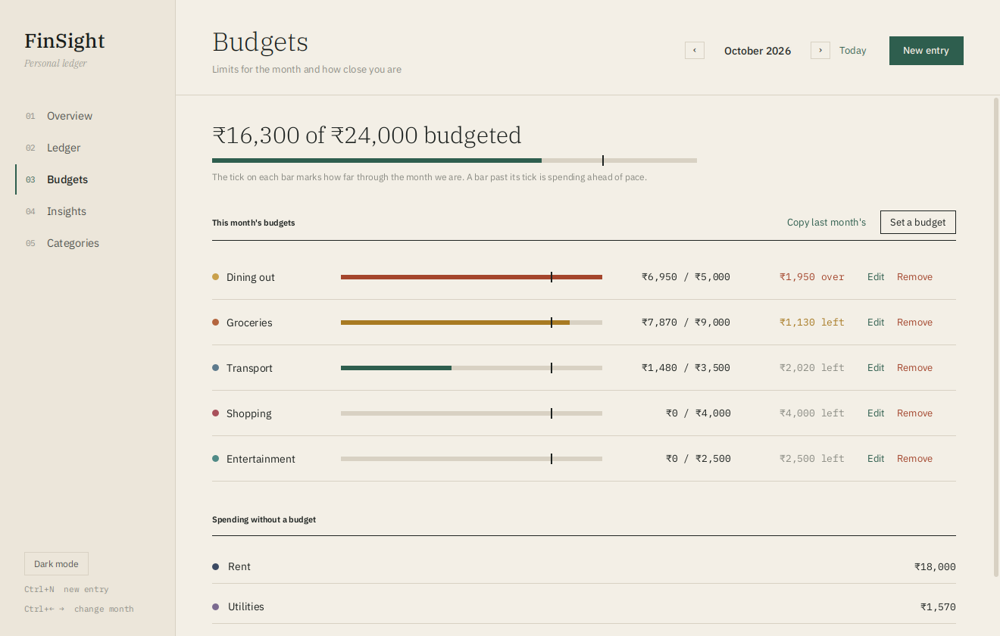
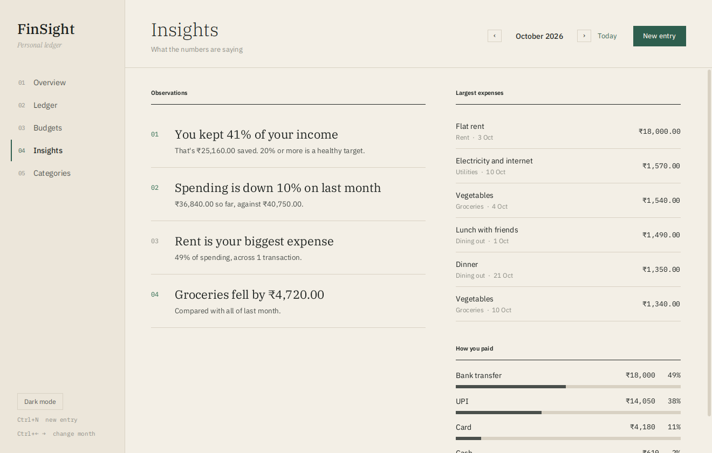
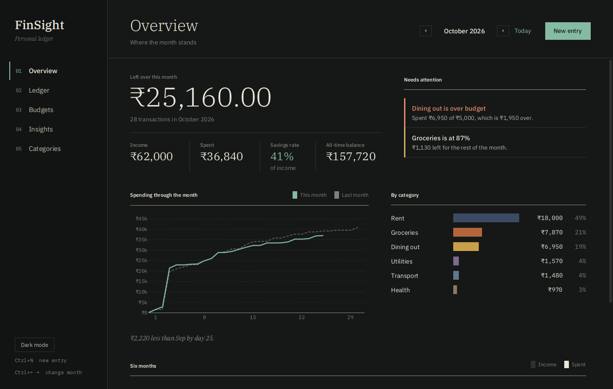
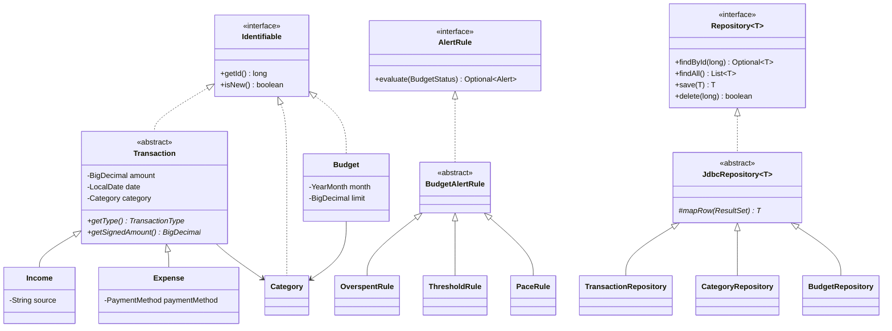

# FinSight

A personal finance manager for the desktop, built with **Java 21**, **JavaFX** and **SQLite**.

Track income and expenses, group them into categories, set monthly budgets, and see where the money goes through summaries, charts, budget alerts and plain-language insights.



## Features

- **Overview dashboard:** money left over this month, income, spending, savings rate and all-time balance, a running spending curve against last month, spending by category, and a six-month income vs spending chart.
- **Ledger:** every transaction for the month with search, income/expense filters, totals, and add, edit or delete (double-click, Enter, Delete key or right-click).
- **Budgets:** a monthly limit per expense category, with a progress bar, a tick showing how far through the month you are, money left or overspent, and one-click copy from last month.
- **Alerts:** over budget, past 80% of a budget, or spending well ahead of the calendar.
- **Insights:** savings rate, change against last month, biggest category, the category that moved most, largest expenses, and spending by payment method.
- **Categories:** add, rename, recolour and remove (blocked while entries still use them).
- **Light and dark themes**, keyboard shortcuts, and six months of demo data on first launch.

| Ledger | Budgets |
| --- | --- |
|  |  |
| **Insights** | **Dark mode** |
|  |  |

## Running

You need **JDK 21**. Maven is optional, since the repo includes the Maven wrapper.

```bash
./mvnw javafx:run          # start the app (use mvnw.cmd on Windows)
./mvnw test                # run the 30 unit tests
./mvnw package             # build target/finsight.jar
java -jar target/finsight.jar
```

Data is stored in `~/.finsight/finsight.db`. To start fresh, delete that file. To use another file, run with `--db=path/to/file.db`.

| Shortcut | Action |
| --- | --- |
| `Ctrl+N` | New entry |
| `Ctrl+←` / `Ctrl+→` | Previous / next month |
| `Ctrl+1` … `Ctrl+5` | Switch screen |

## Project structure

```
src/main/java/com/finsight
├── App.java      Starts the app and wires everything together
├── model         Transaction, Income, Expense, Category, Budget
├── alert         AlertRule interface, the three rules, and AlertEngine
├── dao           Database, Repository<T>, JdbcRepository<T> and one repository per table
├── service       FinanceService (reports), InsightService, DemoData
└── ui            MainWindow, AppContext, views, dialogs and chart components
src/main/resources/com/finsight
├── db/schema.sql SQLite schema: tables, constraints, triggers, views
├── css           The stylesheet, with light and dark palettes
└── fonts         IBM Plex Sans, Serif and Mono (SIL Open Font License)
```

The app is layered: the **UI** talks only to **services** and **repositories**, repositories talk to **SQLite**, and the **model** classes are shared by all of them and know nothing about the database or the screen.

## Where the OOP concepts live

| Concept | Where to look |
| --- | --- |
| Encapsulation | `Transaction`, `Category`, `Budget` keep fields private and validate every setter (positive amounts, `#RRGGBB` colours, category type must match) |
| Inheritance | `Income` and `Expense` extend `Transaction`; the alert rules extend `BudgetAlertRule`; repositories extend `JdbcRepository<T>`; screens extend `View`; dialogs extend `FormDialog<R>` |
| Abstraction | `Transaction`, `View`, `FormDialog` and `JdbcRepository` are abstract; `BudgetAlertRule.evaluate()` is a template method whose steps subclasses fill in |
| Polymorphism | `getSignedAmount()` returns `+amount` for income and `-amount` for expenses, so a mixed list sums to the balance; `AlertEngine` runs any `AlertRule`; `MainWindow` shows any `View` |
| Interfaces | `Identifiable`, `Repository<T>`, `AlertRule`, plus `Comparable<Transaction>` |



## Database

SQLite, with a normalized schema that mirrors the class hierarchy (a shared `txn` table plus `income_detail` and `expense_detail`). It uses foreign keys, `CHECK` and `UNIQUE` constraints, triggers and three reporting views. See [docs/database.md](docs/database.md) for the ER diagram, design decisions and example queries.

## Design

The interface takes its cues from printed financial statements rather than web dashboards: warm paper and ink colours, a serif for headline figures, monospaced numbers so columns line up, hairline rules instead of cards and shadows, and a single green accent. Colour is saved for meaning: category colours in charts, green for good news, rust for overspending.

## Tests

30 JUnit tests cover the model's validation, the alert rules, every repository against an in-memory SQLite database (including the triggers and constraints), and the report numbers adding up.

## License

MIT. The bundled IBM Plex fonts are under the SIL Open Font License (`src/main/resources/com/finsight/fonts/OFL.txt`).
