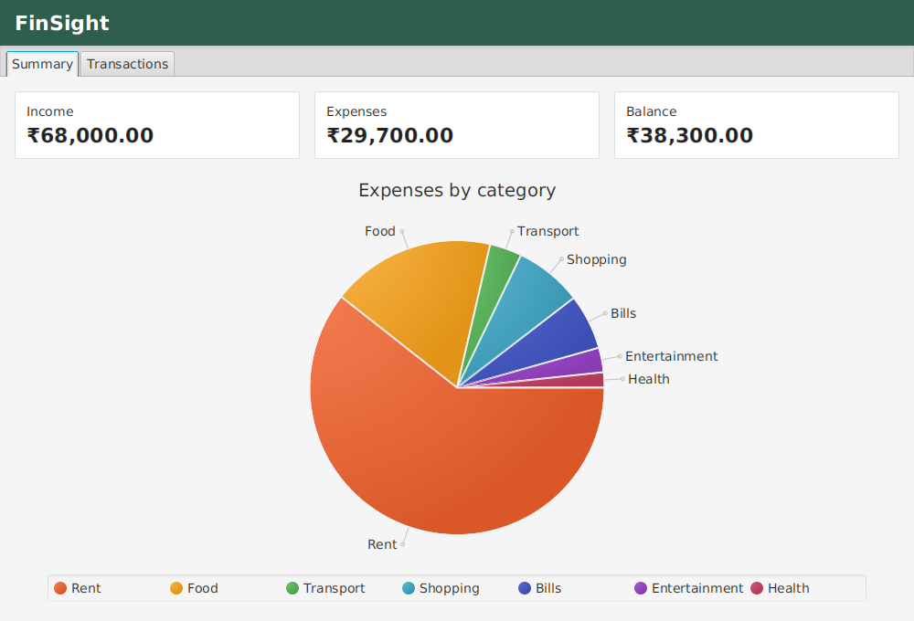
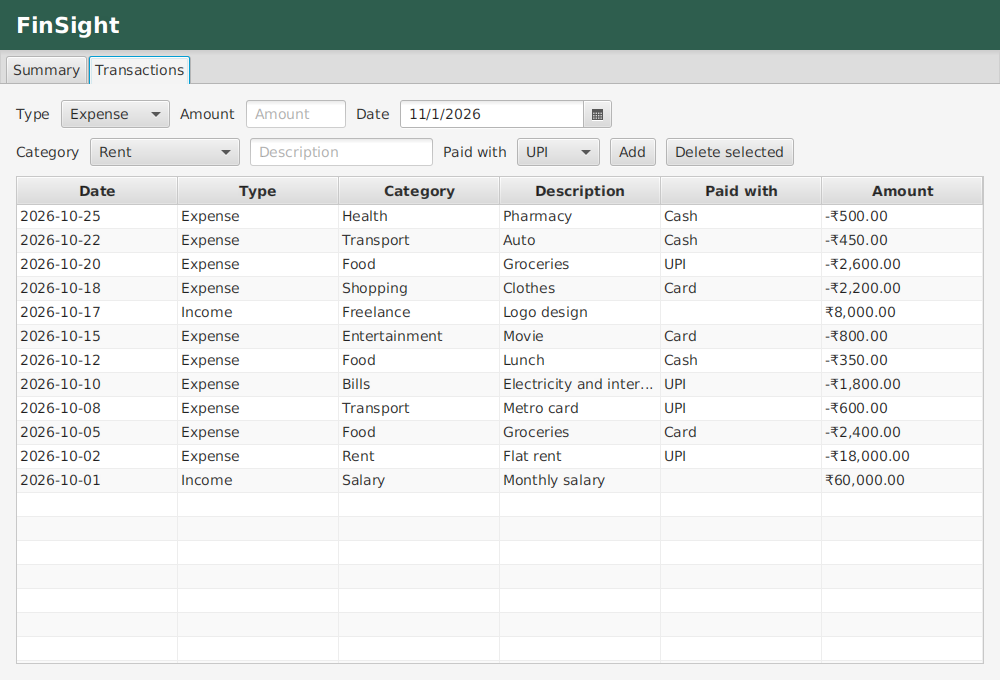

# FinSight

A simple personal finance manager made with **Java**, **JavaFX** and **SQLite**.

You can record income and expenses, and see your total income, expenses and balance with a pie chart of where the money went.



## Features

- **Summary:** total income, expenses and balance, and a pie chart of expenses by category.
- **Transactions:** a form to add income or an expense, and a table of all transactions with Delete.
- Sample data is added the first time the app runs.



## How to run

You need **JDK 21**. Maven is included through the wrapper.

```bash
./mvnw javafx:run     # start the app (mvnw.cmd javafx:run on Windows)
```

Data is saved in a file called `finsight.db` in your home folder; delete it to start fresh.

## Project structure

```
src/main/java/com/finsight
├── App.java                Starts the app, builds the window and tabs
├── model
│   ├── Transaction.java    Abstract parent class for all transactions
│   ├── Income.java         Extends Transaction
│   ├── Expense.java        Extends Transaction, adds payment method
│   └── Categories.java     Fixed lists of categories and payment methods
├── db
│   ├── DBConnection.java   Opens the SQLite file and creates the table
│   ├── TransactionDao.java Saves, loads and deletes transactions
│   └── DemoData.java       Sample data for the first run
└── ui
    ├── Refreshable.java    Interface: refresh(), implemented by both tabs
    ├── SummaryTab.java     Totals and pie chart
    ├── TransactionsTab.java Form and table of transactions
    └── Money.java          Formats amounts as rupees
```

## OOP concepts used

| Concept | Where |
| --- | --- |
| Encapsulation | The fields in `Transaction` are private, with getters and setters. `setAmount` rejects zero or less. |
| Inheritance | `Income` and `Expense` extend `Transaction`. `SummaryTab` and `TransactionsTab` extend JavaFX's `Tab`. |
| Abstraction | `Transaction` is an abstract class with abstract methods `getType()` and `getSignedAmount()`. |
| Polymorphism | `getSignedAmount()` is positive for `Income` and negative for `Expense`, and `Expense` overrides `getPaymentMethod()`. `App.refreshAll()` calls `refresh()` on each tab through the `Refreshable` interface. |
| Interfaces | `SummaryTab` and `TransactionsTab` implement the `Refreshable` interface. |

## Database

One SQLite table, `transactions` (id, type, amount, date, category, description, payment_method).

## License

MIT
