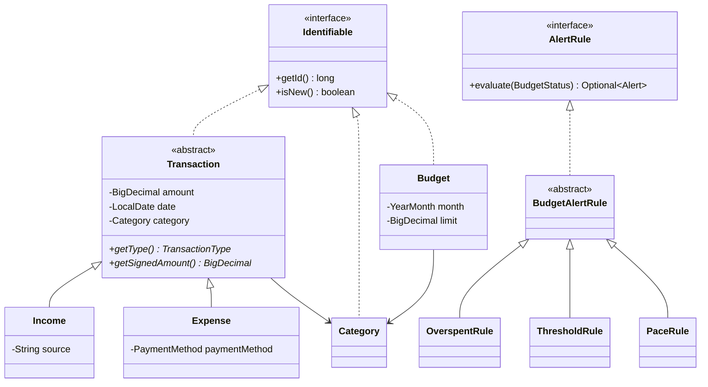

# FinSight

A personal finance manager for the desktop, built with **Java 21**, **JavaFX** and **SQLite**.

Track income and expenses, group them into categories, set monthly budgets per category, and see where the money goes through summaries, charts and budget alerts.

> Status: in progress. The domain model and alert engine are done; storage and the interface are next.

## Features

- Income and expense tracking with categories and payment methods
- Monthly budgets per expense category
- Dashboard with balance, monthly totals and spending charts
- Budget alerts: over budget, nearing the limit, and spending ahead of pace
- Local SQLite database with a normalized schema

## Running

Requires JDK 21 and Maven.

```bash
mvn javafx:run     # start the app
mvn test           # run the unit tests
```

## Project structure

```
src/main/java/com/finsight
├── model    Domain classes: Transaction, Income, Expense, Category, Budget
├── alert    Budget alert rules and the engine that runs them
├── dao      Repository interface and SQLite implementations
├── service  Summaries and insights built on the DAOs
└── ui       JavaFX views and styling
```

## Where the OOP concepts live

| Concept | Where to look |
| --- | --- |
| Encapsulation | `Transaction`, `Category`, `Budget` keep fields private and validate every setter (positive amounts, `#RRGGBB` colours, category type must match) |
| Inheritance | `Income` and `Expense` extend `Transaction`; `OverspentRule`, `ThresholdRule`, `PaceRule` extend `BudgetAlertRule` |
| Abstraction | `Transaction` is abstract; `BudgetAlertRule.evaluate()` is a template method whose steps subclasses fill in |
| Polymorphism | `getSignedAmount()` returns `+amount` for income and `-amount` for expenses, so a mixed list sums to the balance; `AlertEngine` calls each `AlertRule` without knowing its type |
| Interfaces | `Identifiable`, `Repository<T>`, `AlertRule`, plus `Comparable<Transaction>` |



## License

MIT
