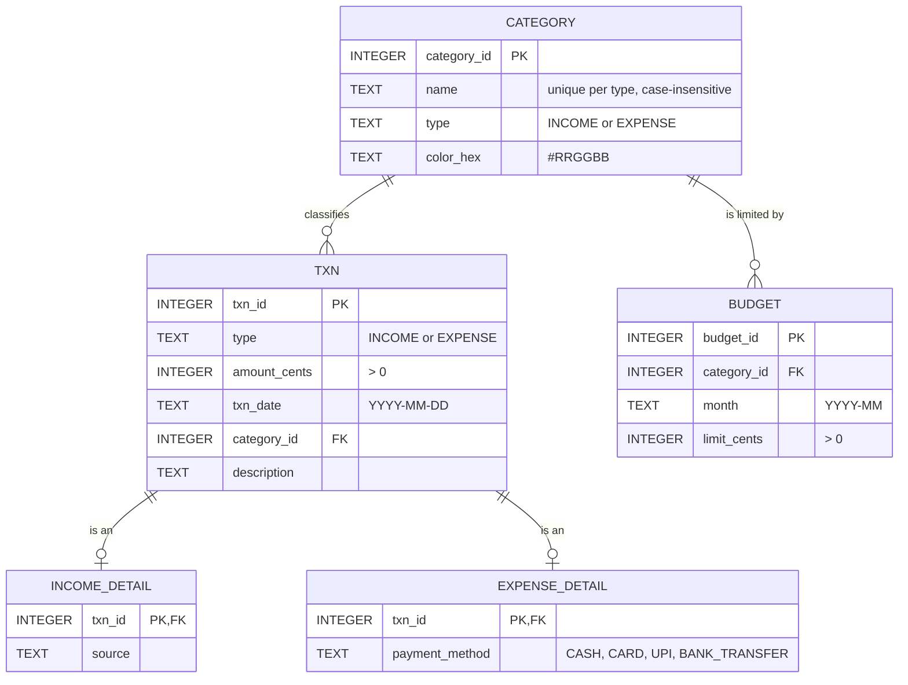

# FinSight database design

FinSight stores everything in a single SQLite file at `~/.finsight/finsight.db`. The full schema is in [`schema.sql`](../src/main/resources/com/finsight/db/schema.sql) and is applied automatically on startup.

## Entity relationship diagram



## Design decisions

**Normalization.** The schema is in third normal form. Category names and colours live only in `category`; transactions and budgets refer to them by key.

**Class table inheritance.** Income and expenses share the `txn` table for the columns they have in common. Columns only one of them needs go in `income_detail` or `expense_detail`, keyed by the same `txn_id`. This mirrors the Java `Transaction`, `Income` and `Expense` classes, and avoids nullable columns that only make sense for one type.

**Money as integers.** Amounts are stored in whole paise (`amount_cents`), so `SUM` is always exact. The Java layer converts to and from `BigDecimal`.

## Integrity rules

| Rule | Enforced by |
| --- | --- |
| Amounts and limits are positive | `CHECK (amount_cents > 0)`, `CHECK (limit_cents > 0)` |
| Dates are valid ISO dates | `CHECK (date(txn_date) = txn_date)` |
| Type and payment method are from a fixed list | `CHECK (... IN (...))` |
| No duplicate category names within a type | `UNIQUE (name COLLATE NOCASE, type)` |
| One budget per category per month | `UNIQUE (category_id, month)` |
| A category in use cannot be deleted | `ON DELETE RESTRICT` on `txn.category_id` |
| Deleting a transaction removes its detail row | `ON DELETE CASCADE` on the detail tables |
| A transaction's type matches its category's type | triggers `trg_txn_category_type_insert` / `_update` |
| Budgets only on expense categories | trigger `trg_budget_expense_only` |

## Views

| View | Used for |
| --- | --- |
| `v_monthly_summary` | Income, expense, net and count per month (dashboard tiles, trend chart) |
| `v_category_totals` | Total per category per month (spending breakdown chart) |
| `v_budget_status` | Each budget with what has been spent against it (`LEFT JOIN`, so untouched budgets show 0) |

## Example queries

Top five expense categories this month:

```sql
SELECT name, total_cents / 100.0 AS total
FROM v_category_totals
WHERE month = strftime('%Y-%m', 'now') AND type = 'EXPENSE'
ORDER BY total_cents DESC
LIMIT 5;
```

Budgets that are over their limit:

```sql
SELECT c.name, s.month, s.spent_cents / 100.0 AS spent, s.limit_cents / 100.0 AS lim
FROM v_budget_status s
JOIN category c USING (category_id)
WHERE s.spent_cents > s.limit_cents;
```

Spending by payment method:

```sql
SELECT e.payment_method, SUM(t.amount_cents) / 100.0 AS total
FROM txn t
JOIN expense_detail e USING (txn_id)
GROUP BY e.payment_method
ORDER BY total DESC;
```

Average daily spend per month:

```sql
SELECT month, expense_cents / 100.0 / 30 AS avg_daily
FROM v_monthly_summary
ORDER BY month;
```
